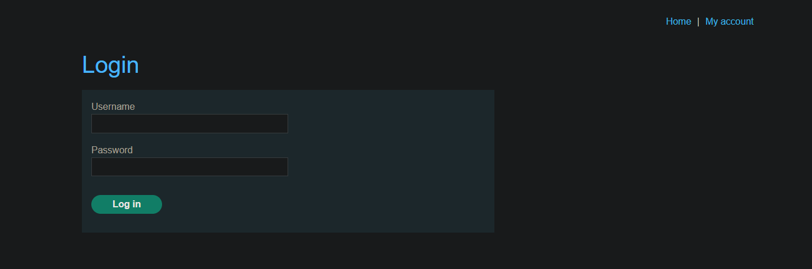
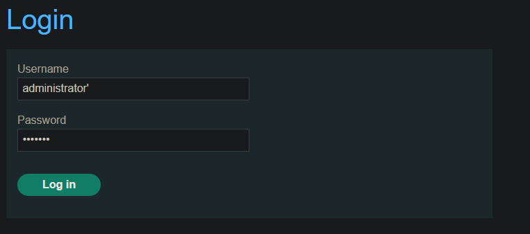
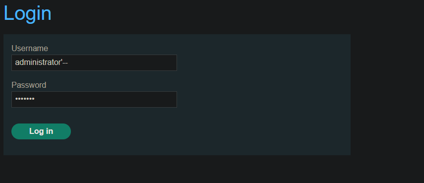
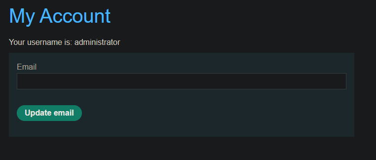

# Lab Report: SQL Injection Vulnerability Allowing Login Bypass

**Platform:** PortSwigger Web Security Academy
**Category:** SQL Injection
**Difficulty:** Apprentice
**Tools used:** Web browser, Burp Suite (optional for traffic inspection)

---

## 1. Summary

The login form of the shop is vulnerable to SQL injection. The username and password submitted by the user are concatenated directly into a SQL query without sanitization or parameterization. By injecting a crafted username that comments out the password check, it is possible to log in as the `administrator` user without knowing the password.

| Item | Detail |
|---|---|
| Vulnerable endpoint | `POST /login` |
| Vulnerable parameter | `username` |
| Vulnerability type | In-band SQL injection (authentication bypass) |
| Authentication required | None |
| Impact in this lab | Full access to the administrator account |

---

## 2. Objective

Perform a SQL injection attack that logs the application in as the `administrator` user.

The login check is performed by a query similar to the following, where the values come directly from the form:

```sql
SELECT * FROM users WHERE username = 'administrator' AND password = 'example'
```

If the query returns a row, the application considers the credentials valid.

---

## 3. Reconnaissance

The application exposes a login page with a username field and a password field. Since the form sends user-controlled data that is very likely used in a database query to validate credentials, it is a good candidate for testing SQL injection.



*Figure 1: The login form under test.*

---

## 4. Vulnerability Discovery

### 4.1 Breaking the query syntax

To check whether the `username` field is injectable, I submitted the value `administrator'` (with a single quote at the end) and an arbitrary password, `example`. A single quote is the string delimiter in SQL, so if the input is concatenated into the query, it will unbalance the quotes and cause a syntax error.



*Figure 2: Test input used in the login form: `administrator'` as username and `example` as password.*

The resulting query on the server side becomes:

```sql
SELECT * FROM users WHERE username = 'administrator'' AND password = 'example'
```

The extra quote leaves the string literal unterminated, which makes the query invalid.

### 4.2 Server response

After submitting the form, the application responded with an **Internal Server Error**. This confirms that the input reaches the SQL engine and alters the structure of the query, which makes SQL injection a valid attack vector.


*Figure 3: The server returns an Internal Server Error after the single quote is injected.*

---

## 5. Exploitation

### 5.1 Payload

The goal is to make the query check only the username and ignore the password condition. The payload used in the `username` field was:

```
administrator'--
```

For the password field, any value works, because it will never be evaluated.



*Figure 4: The login form filled with the payload `administrator'--` as username and an arbitrary password.*

### 5.2 How the payload works

| Part | Purpose |
|---|---|
| `administrator` | The username of the account to impersonate |
| `'` | Closes the string literal that holds the username |
| `--` | Starts a SQL comment, so everything after it is ignored |

The final query executed by the database is:

```sql
SELECT * FROM users WHERE username = 'administrator'--' AND password = 'anything'
```

Everything after `--` is treated as a comment, so the `AND password = ...` condition is never evaluated. The query becomes equivalent to:

```sql
SELECT * FROM users WHERE username = 'administrator'
```

The database returns the administrator row, and the application treats this as a successful authentication.

### 5.3 Result

After submitting the form, the application logged me in as the administrator user. This solves the lab.



*Figure 5: Successful login as `administrator` without knowing the password.*

---

## 6. Root Cause Analysis

The vulnerability exists because the application builds the authentication query by concatenating user input into a string. A simplified example of the vulnerable pattern:

```python
# Vulnerable: user input is concatenated into the query
username = request.form["username"]
password = request.form["password"]
query = ("SELECT * FROM users WHERE username = '" + username +
         "' AND password = '" + password + "'")
user = cursor.execute(query).fetchone()
if user:
    login(user)
```

The application does not separate code (the SQL structure) from data (the user values), so the database cannot tell where the intended query ends and the attacker input begins. In addition, the password check is done inside the SQL query itself, which means that removing that condition is enough to bypass authentication.

---

## 7. Impact

An unauthenticated attacker can log in as any user whose username is known or guessable, including privileged accounts. The consequences include:

- **Confidentiality:** access to the personal data and functionality of the compromised account, and to administrative features.
- **Integrity:** an administrator can usually modify content, users and configuration.
- **Availability:** an administrator can delete data or disable services.
- **Further attacks:** the same injection point can often be extended to read other tables or, depending on database permissions, go further than authentication bypass.

### Severity estimate (CVSS v3.1)

```
CVSS:3.1/AV:N/AC:L/PR:N/UI:N/S:U/C:H/I:H/A:H  ->  9.8 (Critical)
```

This is my own estimate for a pre-authentication bypass that leads to administrator access. In a real assessment, the final score should be adjusted to the context, for example the real privileges of the compromised account and the data it can reach.

---

## 8. Remediation

1. **Use parameterized queries (prepared statements).** This is the primary fix, as it keeps data separated from the SQL structure.

   ```python
   # Fixed: parameterized query
   query = "SELECT id, password_hash FROM users WHERE username = %s"
   user = cursor.execute(query, (username,)).fetchone()
   ```

2. **Verify the password in the application, not in the query.** Retrieve the user by username, then compare the submitted password against a salted hash stored in the database, using a dedicated algorithm such as bcrypt, scrypt or Argon2. Passwords should never be stored or compared in plain text.
3. **Apply the principle of least privilege.** The database account used by the web application should only have the permissions it needs.
4. **Do not expose database errors.** Return a generic error page and log the details server-side. In this lab the Internal Server Error helped confirm the vulnerability.
5. **Add defense in depth on the login flow.** Rate limiting, account lockout or throttling, and multi-factor authentication for privileged accounts reduce the damage of any authentication flaw.

A web application firewall (WAF) can add a layer of protection, but it should not replace the fixes above, since WAF rules can be bypassed.

---

## 9. References

- PortSwigger Web Security Academy, SQL injection: https://portswigger.net/web-security/sql-injection
- OWASP SQL Injection Prevention Cheat Sheet: https://cheatsheetseries.owasp.org/cheatsheets/SQL_Injection_Prevention_Cheat_Sheet.html
- OWASP Password Storage Cheat Sheet: https://cheatsheetseries.owasp.org/cheatsheets/Password_Storage_Cheat_Sheet.html
- CWE-89, Improper Neutralization of Special Elements used in an SQL Command: https://cwe.mitre.org/data/definitions/89.html
